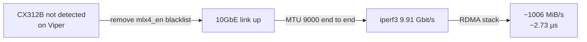
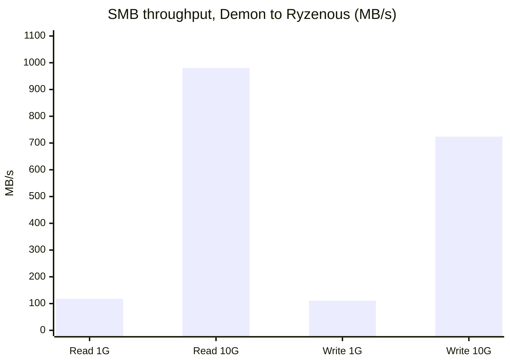

# 2. 10G networking + RDMA

## Goal

Get a low-latency fabric between the nodes and Ryzenous that's fast enough for distributed inference (moving tensors between hosts) and bulk media (stems and libraries).

## What was done

| Step | Change | Result |
| --- | --- | --- |
| 1 | Viper's CX312B wasn't coming up. Removed an `mlx4_en` module **blacklist** | 10GbE link restored |
| 2 | Enabled **jumbo frames** (MTU 9000) on the NICs and the CRS305 | iperf3 **9.91 Gbit/s**, near line rate |
| 3 | Built a full **RDMA** stack on the ConnectX-3 | **~1006 MiB/s**, **~2.73 µs** latency |

### Reading the numbers

- 9.91 Gbit/s over TCP is about 99% of 10G line rate, so jumbo frames removed most of the per-packet overhead.
- RDMA at ~1006 MiB/s is about 8.4 Gbit/s. The win is the **~2.73 µs latency**: ordinary TCP round trips through the kernel are typically tens of microseconds. Latency, not bandwidth, is what dominates layer-by-layer tensor handoffs in split inference.

## SMB storage throughput: 1G vs 10G

The music library share (`//10.10.10.100/srt3`, Ryzenous `E:`) was measured from Demon's Proxmox host. The same share was mounted over each path with identical options, and each figure averages 3 runs of 1 GB with caches dropped. Reads used incompressible random data.

| | 1G (via 192.168.8.101) | 10G (via 10.10.10.100) | Speedup |
| --- | --- | --- | --- |
| Read | **118 MB/s** | **~980 MB/s** (934, ≥1000, ≥1000) | **~8.3×** |
| Write (`conv=fsync`) | **111 MB/s** | **724 MB/s** | **6.5×** |

### Reading the numbers

- **1G is saturated.** 118 MB/s is about 94% of the 125 MB/s line rate, the practical ceiling.
- **10G reads reach ~1 GB/s,** about 80% of line rate. That's in line with the RDMA result (~1006 MiB/s), so SMB with 4 MB rsize/wsize is efficient here.
- **10G writes stop at 724 MB/s,** below reads on the same link, so the write limit is on the Ryzenous side (`E:` write speed or the SMB write path), not the network.
- **Real impact:** a 1,000-track library with stems (~150 GB) takes about **2.5 min per 100 GB to read over 10G versus ~14 min over 1G**. A full write takes about **3.5 min instead of ~23 min** per 150 GB.
- dd prints GB/s above 999 MB/s and rounds to 1.0, so the 10G read average is a lower bound.

## Addressing

- **LAN:** `192.168.8.0/24`. The Flint 2 is `.1`. Nodes are at `.210` / `.220` / `.230`, and their guests at `.211` / `.221` / `.231`.
- **10G fabric:** `10.10.10.0/24` (Demon `10.10.10.230`, Ryzenous `10.10.10.100`).
- Static addressing matters: Demoncrates broke twice from DHCP drift before it was pinned to `.231`.

## Remote access and isolation

- **Tailscale** runs on the Flint 2, so the phone and MacBook reach Home Assistant, Demoncrates and Open WebUI from anywhere.
- Early in the build, a firewall rule blocked Demon from reaching the internet.
- Ryzenous has a scoped SSH key into Demon, which allows deploys and log pulls without manual `.bat` runs.

## Lessons

- Check `lsmod` and `/etc/modprobe.d/` first when a known-good NIC "isn't there."
- Jumbo frames only help if **every hop** is set to MTU 9000: both NICs and the switch.
- An LXC on Proxmox doesn't automatically see the 10G network. Bulk storage still goes over 10G, because the **host** mounts the SMB share via `10.10.10.100` and bind-mounts it into the LXC. Ollama calls from the LXC use the 1G LAN IP, which is fine: prompts and tokens are KB-scale, so the network adds <1% to response time.
- To compare network paths, mount the same share twice (once per IP) with identical options. That isolates the link from disk and protocol effects.
