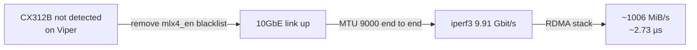

# 2. 10G networking + RDMA

## Goal

Get a low-latency fabric between the nodes and Ryzenous that's fast enough for distributed inference (moving tensors between hosts) and bulk media (stems and libraries).

## What was done

| Step | Change | Result |
| --- | --- | --- |
| 1 | Viper's CX312B wasn't coming up. Removed an `mlx4_en` module **blacklist** | 10GbE link restored |
| 2 | Enabled **jumbo frames** (MTU 9000) on the NICs and the CRS305 | iperf3 **9.91 Gbit/s**, near line rate |
| 3 | Built a full **RDMA** stack on the ConnectX-3 | **~1006 MiB/s**, **~2.73 µs** latency |

### Reading the numbers

- 9.91 Gbit/s over TCP is about 99% of 10G line rate, so jumbo frames removed most of the per-packet overhead.
- RDMA at ~1006 MiB/s is about 8.4 Gbit/s. The win is the **~2.73 µs latency**: ordinary TCP round trips through the kernel are typically tens of microseconds. Latency, not bandwidth, is what dominates layer-by-layer tensor handoffs in split inference.

## Addressing

- **LAN:** `192.168.8.0/24`. The Flint 2 is `.1`. Nodes are at `.210` / `.220` / `.230`, and their guests at `.211` / `.221` / `.231`.
- **10G fabric:** `10.10.10.0/24` (e.g. Demon at `10.10.10.230`).
- Static addressing matters: Demoncrates broke twice from DHCP drift before it was pinned to `.231`.

## Remote access and isolation

- **Tailscale** runs on the Flint 2, so the phone and MacBook reach Home Assistant, Demoncrates and Open WebUI from anywhere.
- Early in the build, a firewall rule blocked Demon from reaching the internet.
- Ryzenous has a scoped SSH key into Demon, which allows deploys and log pulls without manual `.bat` runs.

## Lessons

- Check `lsmod` and `/etc/modprobe.d/` first when a known-good NIC "isn't there."
- Jumbo frames only help if **every hop** is set to MTU 9000: both NICs and the switch.
- An LXC on Proxmox doesn't automatically see the 10G network. Services in Demon's LXC reach Ollama on Ryzenous over the LAN IP.
