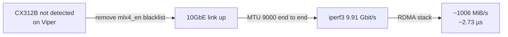
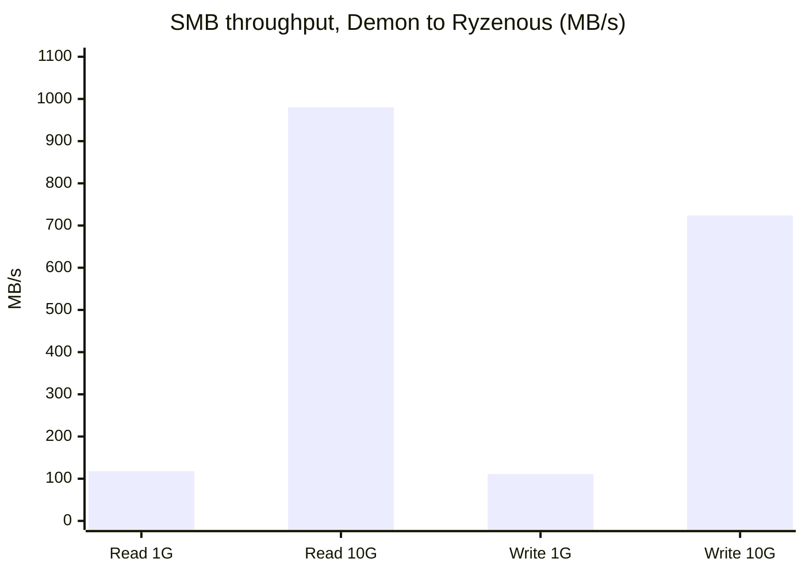

# 2. 10G networking + RDMA

## Goal

Get a low-latency fabric between the nodes and Ryzenous that's fast enough for distributed inference (moving tensors between hosts) and bulk media (stems and libraries).

## What was done

| Step | Change | Result |
| --- | --- | --- |
| 1 | Viper's CX312B wasn't coming up. Removed an `mlx4_en` module **blacklist** | 10GbE link restored |
| 2 | Enabled **jumbo frames** (MTU 9000) on the NICs and the CRS305 | iperf3 **9.91 Gbit/s**, near line rate |
| 3 | Built a full **RDMA** stack on the ConnectX-3 | **~1006 MiB/s**, **~2.73 µs** latency |

### Reading the numbers

- 9.91 Gbit/s over TCP is about 99% of 10G line rate, so jumbo frames removed most of the per-packet overhead.
- RDMA at ~1006 MiB/s is about 8.4 Gbit/s. The win is the **~2.73 µs latency**: ordinary TCP round trips through the kernel are typically tens of microseconds. Latency, not bandwidth, is what dominates layer-by-layer tensor handoffs in split inference.

## Re-benchmark with monitoring (2026-10-16)

Run from Viper to Demon over `10.10.10.x` with iperf3 (4 streams, 45 s per phase), using [`config/scripts/srt3-iperf.sh`](../config/scripts/srt3-iperf.sh). The script writes its results to Prometheus (`srt3_iperf_*`), and Grafana shows them under **SRT3 Network → 10G fabric**.

| Phase | Throughput | TCP retransmits |
| --- | --- | --- |
| Push (Viper → Demon) | **9.90 Gbit/s** | 443 |
| Pull (Demon → Viper) | **9.89 Gbit/s** | 4,171 |
| Both directions at once | **19.70 Gbit/s** combined | 3,540 |

- Both directions are at line rate, matching the original 9.91 Gbit/s, so the fabric hasn't degraded.
- Demon sends about 10× more retransmits than Viper. That's still a small fraction of packets and doesn't cost throughput, but it's worth checking Demon's 10G NIC, cable and optic (open item).
- The 1-minute-averaged "10G traffic per host" panel under-reads short phases (it peaked at ~16.5 Gbit/s during the bidirectional phase). The "10G live" panel uses per-scrape rates and shows the plateaus at full height.

## SMB storage throughput: 1G vs 10G

The music library share (`//10.10.10.100/srt3`, Ryzenous `E:`) was measured from Demon's Proxmox host. The same share was mounted over each path with identical options, and each figure averages 3 runs of 1 GB with caches dropped. Reads used incompressible random data.

| | 1G (via 192.168.8.101) | 10G (via 10.10.10.100) | Speedup |
| --- | --- | --- | --- |
| Read | **118 MB/s** | **~980 MB/s** (934, ≥1000, ≥1000) | **~8.3×** |
| Write (`conv=fsync`) | **111 MB/s** | **724 MB/s** | **6.5×** |

### Reading the numbers

- **1G is saturated.** 118 MB/s is about 94% of the 125 MB/s line rate, the practical ceiling.
- **10G reads reach ~1 GB/s,** about 80% of line rate. That's in line with the RDMA result (~1006 MiB/s), so SMB with 4 MB rsize/wsize is efficient here.
- **10G writes stop at 724 MB/s,** below reads on the same link, so the write limit is on the Ryzenous side (`E:` write speed or the SMB write path), not the network.
- **Real impact:** a 1,000-track library with stems (~150 GB) takes about **1.7 min per 100 GB to read over 10G versus ~14 min over 1G**. A full write takes about **3.5 min instead of ~23 min** per 150 GB.
- dd prints GB/s above 999 MB/s and rounds to 1.0, so the 10G read average is a lower bound.

## Addressing

- **LAN:** `192.168.8.0/24`. The Flint 2 is `.1`. Nodes are at `.210` / `.220` / `.230`, and their guests at `.211` / `.221` / `.231`.
- **10G fabric:** `10.10.10.0/24` (Demon `10.10.10.230`, Ryzenous `10.10.10.100`).
- Static addressing matters: Demoncrates broke twice from DHCP drift before it was pinned to `.231`.

## Remote access and isolation

- **Tailscale** runs on the Flint 2, so the phone and MacBook reach Home Assistant, Demoncrates and Open WebUI from anywhere.
- Early in the build, a firewall rule blocked Demon from reaching the internet.
- Ryzenous has a scoped SSH key into the Demoncrates LXC (deploys and log pulls without manual `.bat` runs), plus key-based root SSH to Demon's Proxmox host for host-level work such as mounts and benchmarks.

## Lessons

- Check `lsmod` and `/etc/modprobe.d/` first when a known-good NIC "isn't there."
- Jumbo frames only help if **every hop** is set to MTU 9000: both NICs and the switch.
- An LXC on Proxmox doesn't automatically see the 10G network. Bulk storage still goes over 10G, because the **host** mounts the SMB share via `10.10.10.100` and bind-mounts it into the LXC. Ollama calls from the LXC use the 1G LAN IP, which is fine: prompts and tokens are KB-scale, so the network adds <1% to response time.
- To compare network paths, mount the same share twice (once per IP) with identical options. That isolates the link from disk and protocol effects.

## IoT network (Flint 2)

The router's built-in IoT network (`br-iot`, Wi-Fi `currynet-iot`, 2.4 GHz) is a separate subnet, `192.168.10.0/24`. Firewall:

- **IoT → LAN:** blocked. IoT devices get DHCP, DNS (AdGuard) and internet only.
- **LAN → IoT:** blocked, except **Home Assistant `192.168.8.221`** (full access) and **Hellcat `192.168.8.220`** (ping only, for monitoring). Rules `SRT3-HomeAssistant-to-IoT` and `SRT3-Hellcat-ping-IoT`.
- The NicGiga S25-0802P is unmanaged (no VLANs), so wired devices behind it stay on the main LAN.

**Address plan:**

| Range | Category | Assigned |
| --- | --- | --- |
| `.10–.19` | Power (plugs, strips) | HS300 `.10` |
| `.20–.29` | Climate / sensors | ecobee `.20` |
| `.30–.39` | Lighting | KL60 bulb `.30` |
| `.40–.49` | Media | reserved (TV and soundbar stay on main LAN for AirPlay) |
| `.50–.59` | Cameras / security | reserved |
| `.100–.249` | DHCP pool | anything here hasn't been catalogued yet |

Router script with backup and undo: [`config/router/router-iot.sh`](../config/router/router-iot.sh).

**Gotcha (2026-10-16):** the Home Assistant VM had a second NIC (`enp6s19`) with a static `192.168.10.221/24` left over from earlier. So HA treated the whole IoT subnet as directly attached, sent its traffic out that NIC (which isn't on the IoT network), and never reached the router. The TP-Link integration failed with `Errno 113` (no route to host) and kept asking for cloud credentials, and the HS300 sensors went unavailable from 22:16 on Oct 15. The router's connection table showed no HA traffic to `.10.10` at all, which pointed at HA itself. The fix was to disable IPv4 on `enp6s19` (HA → Settings → System → Network) and reload the integration. **Before moving devices to a new subnet, check that no host already has an address in it.**
