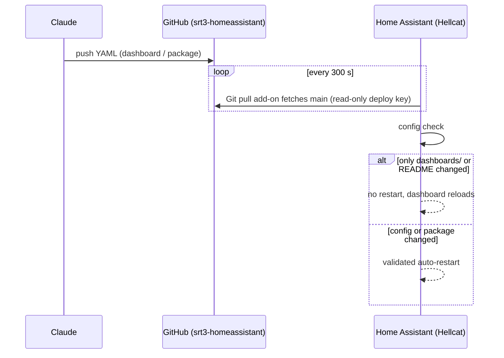
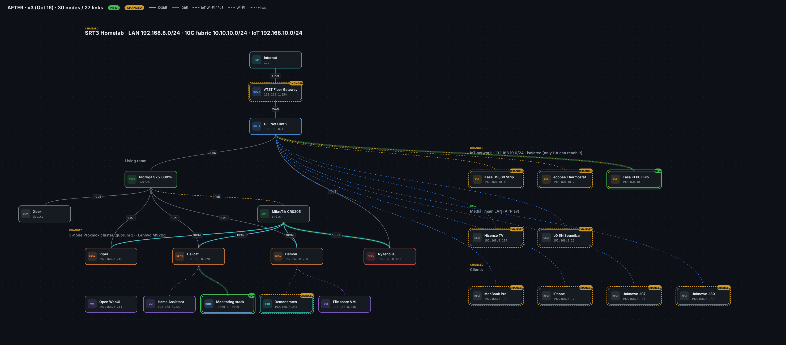

# 3. Home Assistant GitOps

Home Assistant runs as a HAOS VM on Hellcat (`192.168.8.221:8123`). Its YAML config lives in a private GitHub repo, **`srt3-homeassistant`**. Claude edits the repo and HA pulls the changes, so dashboard and sensor work happens without touching the HA UI.

## Ownership split

| Owned by git | Owned by the HA UI (gitignored) |
| --- | --- |
| `configuration.yaml`, `packages/claudey.yaml`, `dashboards/claudey.yaml`, `README.md` | automations / scripts / scenes, `.storage`, HACS `custom_components`, themes, `www` |

## Claudey dashboard

- **Mode and URL:** YAML mode at `/dashboard-claudey`. HA needs a hyphen in dashboard keys.
- **Cards:** built with Mushroom from HACS.
- **Views:** **Home**, **SRT3** (cluster), and **System**.
- **Power:** per-node watts, `sensor.srt3_cluster_power`, energy today/month, and cost (rate in `sensor.srt3_electricity_rate`, $0.45/kWh assumed).
- **Ryzenous Wake-on-LAN:** `switch.ryzenous_desktop`.
- **Automations:** a node-down phone alert (excludes Hellcat, since it hosts HA), a ranked per-device power table, and a maintenance watchdog for pending updates and stale backups.

## Homelable

A network-map panel inside HA at `/homelable`, written through HA's WebSocket API (`homelable/get_canvas`, `homelable/save_canvas`), because the panel's shadow DOM blocks UI automation.

The current map (v3, Oct 16) has **30 nodes and 27 links**:

- **Internet path:** AT&T gateway (`192.168.1.254`) → Flint 2 (`.1`, AdGuard Home, Tailscale) → NicGiga.
- **Cluster:** Viper, Hellcat and Demon on 1G from the NicGiga and 10G from the CRS305. Ryzenous takes 1G from the Flint 2 and 10G from the CRS305.
- **Guests:** Open WebUI (`.211`), Home Assistant (`.221`), the Hellcat monitoring stack (Prometheus, Grafana, Alertmanager), Demoncrates (LXC 101, `.231`), and the file-share VM (`.236`).
- **IoT network (`192.168.10.0/24`):** HS300 `.10`, ecobee `.20`, KL60 `.30`, shown as isolated.
- **Main LAN media and clients:** Hisense TV, LG soundbar, MacBook Pro, iPhone, and two unidentified clients (`.107`, `.130`).

The same layout is saved as two designs, "Network Topology" and "SRT3 Network". Each earlier version is kept as a backup design.

**Lessons:**
- Homelable links each node to a scanned device by IP, and the label lives on the device record. Two nodes with the same IP merge, and the last save wins. A service on a host (such as the monitoring stack) needs its own node with no IP; its health check then targets the URL.
- An open Homelable tab that still has an old canvas loaded can save it over newer changes. Reload every tab after an API write.

## Limits

Claude can't reach the LAN, so it can't read HA logs or states or add integrations. Those go through the HA UI.

## Debugging notes

- **Ollama holding 8 GB of VRAM overnight:** HA's conversation integration loaded the model with no keep-alive timeout. The fix is a Keep Alive value in the Ollama integration.
- The GitHub App has to be **installed** on the repo, not just authorized.
