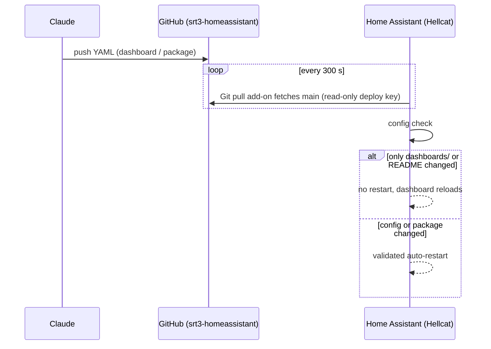

# 3. Home Assistant GitOps

Home Assistant runs as a HAOS VM on Hellcat (`192.168.8.221:8123`). Its YAML config lives in a private GitHub repo, **`srt3-homeassistant`**. Claude edits the repo and HA pulls the changes, so dashboard and sensor work happens without touching the HA UI.

## Ownership split

| Owned by git | Owned by the HA UI (gitignored) |
| --- | --- |
| `configuration.yaml`, `packages/claudey.yaml`, `dashboards/claudey.yaml`, `README.md` | automations / scripts / scenes, `.storage`, HACS `custom_components`, themes, `www` |

## Claudey dashboard

- **Mode and URL:** YAML mode at `/dashboard-claudey`. HA needs a hyphen in dashboard keys.
- **Cards:** built with Mushroom from HACS.
- **Views:** **Home**, **SRT3** (cluster), and **System**.
- **Power:** per-node watts, `sensor.srt3_cluster_power`, energy today/month, and cost (rate in `sensor.srt3_electricity_rate`, $0.45/kWh assumed).
- **Ryzenous Wake-on-LAN:** `switch.ryzenous_desktop`.
- **Automations:** a node-down phone alert (excludes Hellcat, since it hosts HA), a ranked per-device power table, and a maintenance watchdog for pending updates and stale backups.

## Homelable

A network-map panel inside HA at `/homelable`. It holds a 27-node diagram covering the internet path, cluster, VMs, IoT and clients. It was written through HA's WebSocket API, because the panel's shadow DOM blocks UI automation.

## Limits

Claude can't reach the LAN, so it can't read HA logs or states or add integrations. Those go through the HA UI.

## Debugging notes

- **Ollama holding 8 GB of VRAM overnight:** HA's conversation integration loaded the model with no keep-alive timeout. The fix is a Keep Alive value in the Ollama integration.
- The GitHub App has to be **installed** on the repo, not just authorized.
