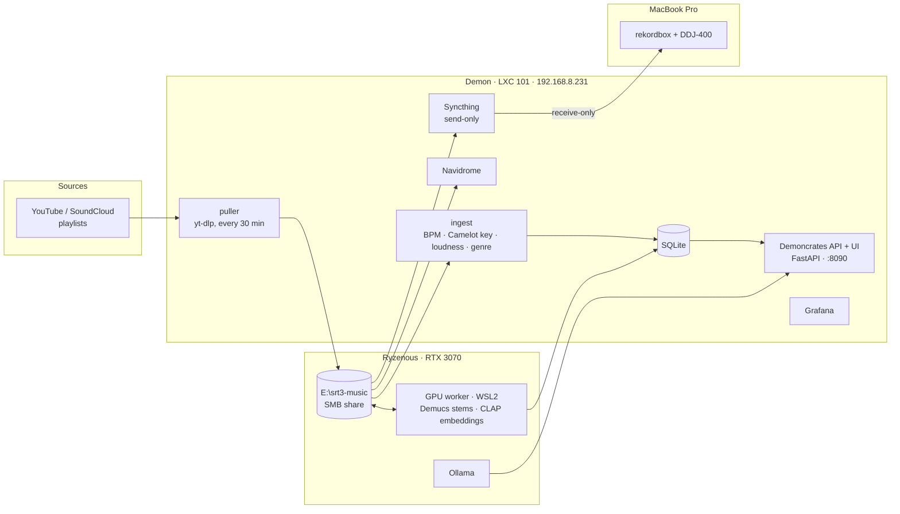

# 4. Demoncrates

A self-hosted AI DJ system. It pulls tracks, analyzes them, splits stems on the GPU, and serves a web app that suggests the next track, plans sets, finds mashups, and answers questions through a local LLM. Everything lands in rekordbox for a Pioneer DDJ-400. The name started as "SRT3 Brain".

## Pipeline

## Where things live

| Component | Host | Notes |
| --- | --- | --- |
| Library audio | Ryzenous `E:\srt3-music` | SMB → CIFS automount on the Proxmox host → bind mount into the LXC at `/srv/music` |
| SQLite DB | Demon local disk | Kept off SMB, because WAL locking over SMB risks corruption |
| GPU worker | Ryzenous (Docker in WSL2) | Demucs stem separation, CLAP audio embeddings |
| LLM | Ryzenous (native Ollama) | Reached over the LAN IP from the LXC |
| Performance | MacBook | One-way Syncthing mirror plus rekordbox XML export (crates/energy/sources as playlists) |

## App features

- **Next track:** suggestions by key, BPM, energy and CLAP similarity.
- **Set Planner:** a beam search over the library.
- **Mashups:** beat-aligned previews using tempo and downbeat grids measured from the drum stems.
- **Vibe search:** plain-English search over CLAP embeddings.
- **Ask:** questions answered by the local LLM.
- **Grow:** bulk-add tracks by criteria.
- **Library:** waveform scrubbing, queue playback, and a Now Playing screen.
- **Versioning:** semver, with an in-app changelog.

## Ops

- Static IP `.231`, after DHCP drift broke links twice.
- Claude deploys and pulls logs over a scoped SSH key. This replaced an earlier Windows tray "helper" with a fixed job menu.
- A weekly scheduled email suggests new releases plus mixing drills.
- Plan about **150 GB per 1,000 tracks** once stems are stored.
