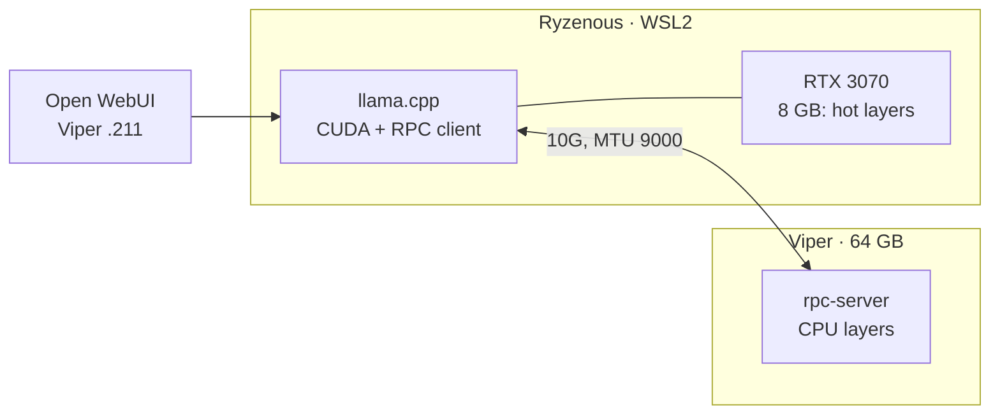

# 5. Distributed inference (in progress)

## Goal

Run models larger than the RTX 3070's 8 GB can hold by splitting layers between the GPU on Ryzenous and Viper's 64 GB of RAM. The two hosts are joined by the low-latency 10G/RDMA link from [doc 2](02-networking-10g-rdma.md).

## Status

| Step | State |
| --- | --- |
| 10G + jumbo frames + RDMA between hosts | ✅ done |
| Build llama.cpp with `GGML_CUDA=ON` and `GGML_RPC=ON` on Ryzenous (WSL2) | 🟡 in progress |
| Build and run `rpc-server` on Viper | ⬜ |
| Benchmark: 3070 alone vs. 3070 + Viper RPC (tokens/s, time to first token) | ⬜ |
| Point Open WebUI at the split backend | ⬜ |

## What to measure

- Tokens/s and time to first token at each split ratio.
- How much of each token's time is spent on the network: compare TCP against the RDMA path.
- Watts per token, using the HS300 per-node power sensors in Home Assistant.

## Notes

- WSL2 sits behind a virtual NIC, so check that it actually uses the 10G path (MTU and routing) before benchmarking.
- Hardware option under consideration: a used RTX 3090 (24 GB), which would run 30B-class models fully on the GPU and make the split far more interesting.
