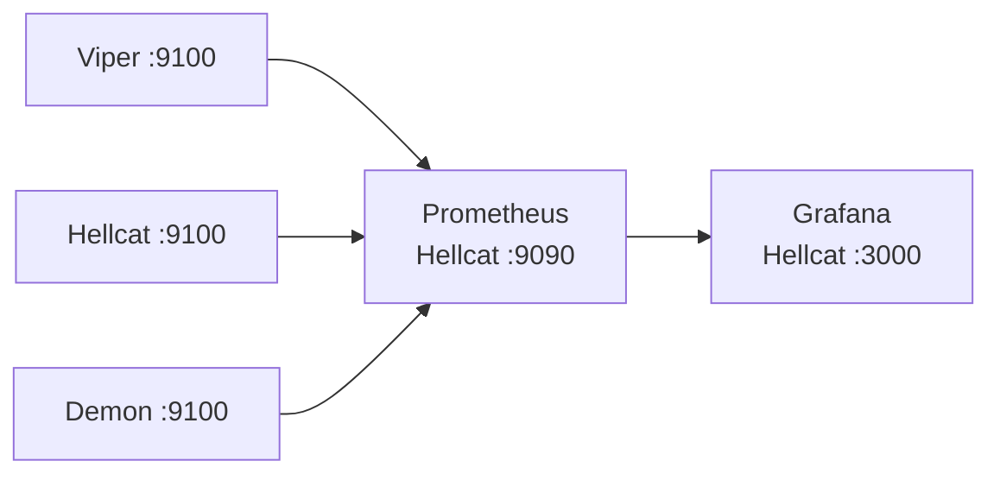

# 6. Observability: Prometheus + Grafana

**Goal:** one place to see the health, compute load, and per-NIC 1G/10G traffic of every node, as the base layer for measuring everything that follows.

## What was done

| Component | Where | Address |
| --- | --- | --- |
| Grafana 13.2.3 | Hellcat host | `http://192.168.8.220:3000` |
| Prometheus (Debian package) | Hellcat host | `http://192.168.8.220:9090`, 15 s scrape |
| node_exporter | Viper, Hellcat, Demon | `:9100` on each host |

- Prometheus scrape job `node` with a `node` label per host (`viper`, `hellcat`, `demon`). Config is at `/etc/prometheus/prometheus.yml` on Hellcat.
- Grafana's default data source `prometheus` points at Hellcat:9090.
- **SRT3 Overview** dashboard (`/d/srt3-overview`), built through the Grafana API:
  - **Health:** node up, CPU %, RAM %, uptime, root disk %, max hwmon temp
  - **Compute:** CPU %, memory, load, disk I/O
  - **Network:** RX/TX per physical NIC (virtual bridges and taps filtered out), errors and drops, link speed and MTU table
- The community **Node Exporter Full** dashboard was already imported.

## First readings (2026-10-15, right after bring-up)

| Node | CPU busy | RAM used | Max temp | Root disk |
| --- | --- | --- | --- | --- |
| Viper | 64 % | 10 % | 45 °C | 6 % |
| Hellcat | 72 % | 78 % | 50 °C | 5 % |
| Demon | 74 % | 20 % | 43 °C | 2 % |

CPU was measured minutes after the install ran, so it isn't a baseline yet.

## Status

Running. Not yet covered: Ryzenous (windows_exporter + NVIDIA GPU exporter), HS300 power, Loki logs, and alerting.

## Lessons

- Viper dropped off the LAN ("no route to host") and needed a hard restart before node_exporter could be installed. The Uptime and Node up tiles now make a repeat of that visible.
- A setup script with `set -e` that SSHes into several nodes aborts on the first unreachable host. Use `|| echo skipped` per host instead.
- Grafana held three broken duplicate Prometheus data sources (`prometheus-1/2/3`) from earlier attempts.
