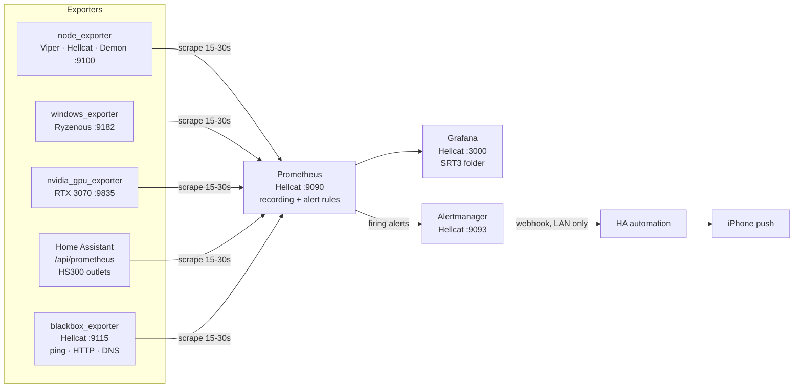

# 6. Observability: Prometheus + Grafana + Alertmanager

**Goal:** one place to see whether everything is up, how hard it's working, what it costs, and how the network is behaving, with alerts on the phone when something breaks.

## Architecture

| Component | Where | Notes |
| --- | --- | --- |
| Prometheus 2.53 (Debian pkg) | Hellcat host `:9090` | 15 s scrape, 90 d / 8 GB retention cap |
| Alertmanager (Debian pkg) | Hellcat `:9093` | → HA webhook → `notify.justins_iphone` |
| blackbox_exporter (Debian pkg) | Hellcat `:9115` | 10 ping targets, 8 HTTP checks, 2 DNS checks |
| node_exporter (Debian pkg) | all 3 Proxmox hosts `:9100` | Virtual NICs + ZFS dataset mounts excluded at source |
| windows_exporter (MSI) | Ryzenous `:9182` | Collectors: cpu, memory, logical/physical disk, net, os, system, time |
| nvidia_gpu_exporter (winget, service) | Ryzenous `:9835` | Firewall allows Hellcat only |
| HA `prometheus:` integration | HA VM `/api/prometheus` | HS300 outlets (W, plus today/month/total kWh since 2026-10-17), `sensor.srt3_*`, climate; token in `/etc/prometheus/ha_token` |
| Grafana 13.2.3 | Hellcat, Docker (`/opt/monitoring`) | Home dashboard = SRT3 Overview |

Configs live in [`config/`](../config): `prometheus/` (scrape config, rules, Alertmanager, blackbox), `grafana/` (dashboard JSON + the generator `gen_dash.py`), `ryzenous/`, `scripts/hellcat-setup.sh` (bootstrap).

## Dashboards (Grafana → SRT3 folder)

| Dashboard | What it answers |
| --- | --- |
| **SRT3 Overview** (home) | Is anything down? Headline power/cost/ping/loss/10G. Per-host CPU, RAM, disk, temp bars (click → host detail). Hop-by-hop ping. Outlet power. GPU gauges. Maintenance (updates, NVMe wear, failed services, reboot needed). Firing alerts. |
| **SRT3 Host Detail** (`$node`) | CPU by mode, memory incl. ZFS ARC, per-NIC traffic (in up / out down), disk I/O, temps, filesystems, NVMe SMART, apt/reboot/failed units |
| **SRT3 Network** | Ping per hop + Cloudflare latency heatmap, packet loss, DNS time, 10G fabric (incl. a per-scrape "10G live" graph and the last iperf3 run: Gbit/s, retransmits, when), NIC rows repeated per host, interface table (speed/MTU/util), router, AdGuard, service response times + TLS cert days |
| **SRT3 GPU & Power** | RTX 3070 util/VRAM/power vs limit/temp/fan/clocks/throttle reasons; per-outlet watts, 24 h kWh, idle floor, $/month; **Energy row** from the HS300's own kWh meters: today and month-to-date kWh and $, cluster share, per-outlet today/month, 7-day daily running totals |
| Node Exporter Full | Community dashboard, every Linux metric |

Features used: recording rules (`srt3:*`), template variables + repeated rows, data links, annotations (reboots, alerts), shared crosshair, state timeline, heatmap, transforms (merge/organize), table cell coloring, incremental query caching.

## Alerts (phone = critical/warning, dashboard-only = info)

NodeDown, ServiceDown, InternetDown, InternetLatencyHigh, PacketLoss, NICErrors, TenGigLinkDegraded, JumboFramesLost, HighCPU, MemoryPressure, DiskFillingUp (`predict_linear` 7 d), HostHot, GPUHot, ServiceFailed, NVMeMediaErrors, NVMeWearHigh, ScrapeTargetMissing · info: NodeRebooted, DNSSlow, ClusterPowerHigh, RebootRequired, UpdatesPiling. Inhibition: NodeDown suppresses that host's service alerts; InternetDown suppresses latency/loss.

## Measured (2026-10-15)

**Scrape efficiency, node_exporter per Linux host:** 1,797 → **1,217** samples/scrape (−32%), while gaining NVMe SMART, apt-pending, reboot-required and failed-unit data. Virtual NICs tracked 30 → 0; filesystems 40 → 14. Total samples per scrape cycle stayed ≈ 6,000 while coverage grew from 3 Linux hosts to + Ryzenous, GPU, 6 outlets, 8 services, 10 ping targets, DNS, Alertmanager. Prometheus RSS ≈ 90–115 MB.

**First readings:**

| | Value |
| --- | --- |
| Cluster power (Viper + Hellcat + Demon) | 51.9 W → ≈ $15/month at $0.45/kWh |
| Outlets | Hellcat 22.6 W · TV 17.6 · Demon 15.7 · Viper 13.6 · Soundbar 5.6 · Xbox 0.9 |
| Ping: router / AT&T gateway / Google / Cloudflare | 0.8 / 1.5 / 7.9 / 10.0 ms |
| Ping over 10G vs 1G (Hellcat → Demon) | 0.18 vs 0.24 ms |
| Hellcat memory | 85% of 15.5 GiB: 10.6 GiB process memory (mostly the HA VM), 1.5 GiB ZFS ARC (capped 1.55), monitoring stack ≈ 0.3 GiB |
| apt updates pending | Hellcat 289 · Viper 250 · Demon 240 |

## Issues found by the new monitoring

1. **Demon 10G MTU misconfigured.** `/etc/network/interfaces` had `mtu 9000` under `nic0` (1G) instead of `enp1s0d1` (10G), so vmbr1 advertised 9000 over a 1500-byte port. Caught by `JumboFramesLost` on its first evaluation. Fixed; a 9000-byte DF ping Demon → Viper over 10G now passes.
2. **Duplicate node_exporters.** Each node ran an older `prom/node-exporter` Docker container on `:9100` (from an earlier attempt), so the packaged exporter crash-looped and tuning had no effect. Containers stopped with `restart=no` (kept; undo: `docker update --restart=unless-stopped node-exporter && docker start node-exporter`). Hellcat's `/opt/monitoring` compose also holds a dead `prometheus` container and the live `grafana` container.
3. **Viper `swapfile.swap` failed** since boot: an 8 GB `/swapfile` on ZFS ("appears to have holes"); the zvol swap on the next fstab line is the working one.
4. **Three broken Grafana data sources** from the earlier attempt; deleted.

5. **HS300 power went unavailable (Oct 15, 22:16 → Oct 16).** It was caused by the HA VM's stray `192.168.10.221` NIC after the strip moved to the IoT subnet. See [doc 2](02-networking-10g-rdma.md#iot-network-flint-2). The minute-level watts for that window are lost. The day and month kWh totals were not, because the strip counts them itself. That's why the Energy row reads the strip's meters and doesn't integrate watts.

## Status

Running. Not yet done: Flint 2 router exporter (optional script in `config/scripts/router-setup.txt`), Loki logs, Ryzenous on a smart plug (power), inference metrics (tokens/s/W), Proxmox VE exporter for per-VM metrics.

## Lessons

- Check what already owns a port before installing an exporter (`ss -ltnp 'sport = :9100'`); Docker leftovers are invisible to `systemctl`.
- Speed/MTU come from node_exporter's **netclass** collector; byte counters from **netdev**. Excluding devices needs both flags.
- Debian's node_exporter enables the systemd collector: 213 units × 5 states = 1,065 series per host. Keep only `state="failed"`.
- `ifreload -a -s` exits non-zero on harmless warnings (`bridge-fd 0`); gate on `^error`, not the exit code. Apply network changes detached (`systemd-run`) so a link bounce can't kill them halfway.
- Resolved-alert pushes need their own wording, or "Resolved" reads like a new alert.
- Energy totals belong on the device that meters them (the HS300's kWh counters). A time-series integral breaks whenever the pipeline does.
- In a regex label matcher inside a PromQL double-quoted string, `\.` must be written `\\.`. Use the same escaping as the recording-rule YAML, or the panel errors.
